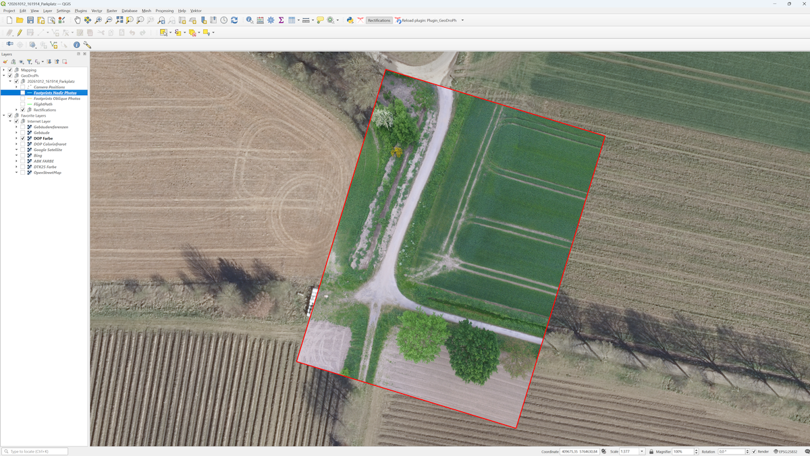

# GeoDroPh – Direct Georeferencing of Drone Photos

GeoDroPh is a QGIS plugin that performs rapid direct georeferencing of DJI drone photos using onboard GNSS/IMU data.  
It calculates the positions and footprints of aerial images and enables 2D and 3D visualization for a quick review
of the aerial survey. It performs rectification of nadir photos and imports them—along with positions, footprints,
flight path, and user-defined layers—directly into QGIS for further spatial analysis.

GeoDroPh is designed for:
- emergency response teams (fire rescue, disaster response, wildlife conservation)
- drone teams that want to check drone images taken on-site immediately
- users who require fast georeferenced imagery without full photogrammetric processing

---

📸 Screenshots
GeoDroPh
XY Visualisation of Aerial Survey
![docs/Screenshot_XY_1.png

Additional screenshots:

[docs/Screenshot_3D_1.png
[Camera Positions and Orientations](docs/
docs/Screenshot_QGIS_SimultaneousNadirView.png
[Simultaneous Oblique View](docs/Screenshot_QGIS_SimultaneousObliqueectification.png

#### Rectified drone photo  

---

## 🚀 Features

- **Fast direct georeferencing** of nadir as well as oblique drone photos
- **Using EXIF GPS/IMU metadata**
- **Computation of positons, footprints and flight path**
- **2D and 3D visualization** for reviewing the aerial survey   
- **Rapid rectification** of nadir images  
- **Automatic import** of GeoDroPh results into QGIS
- **Optional import** of map layers prepared by the user
- **Simultaneous display** of original drone images and correspondingly aligned section of map layers
- **Display of rectifications** on map layers

---

## 📥 Installation

### 🔹 Installation from the QGIS Plugin Repository

1. Open **QGIS**
2. Go to **Plugins → Manage and Install Plugins**
3. Search for **GeoDroPh**
4. Click **Install Plugin**

GeoDroPh will appear in the **Plugins** menu.

**Note:**  
The plugin requires Phil Harvey’s ExifTool.
As executables cannot be copied automatically from the QGIS plugin repository as part of the
GeoDroPh installation, a system-wide installation of ExifTool is **required**.

---

### 🔹 Installation from GitHub (ZIP package)

1. Download the latest release ZIP from GitHub  
2. In QGIS, open **Plugins → Manage and Install Plugins → Install from ZIP**
3. Select the downloaded ZIP file
4. Click **Install Plugin**

**Note:**  
The GitHub ZIP package includes `exiftool.exe` and `exiftool_files`.  
A system-wide ExifTool installation is **not required**.

---

## 🛠 Requirements

GeoDroPh supports the following QGIS versions:

- **QGIS 3.28 LTR – QGIS 3.40.8 (Qt5)**  
- **QGIS 4.2.1 and newer (Qt6)**

GeoDroPh does **not** support:

- **QGIS 3.40.9 – QGIS 4.2.0**
  (these versions use early Qt6 bindings and contain breaking API changes)

The plugin will install in these versions, but **it will not start**, because GeoDroPh performs an internal version check to prevent crashes.

---

## 🧩 Troubleshooting

### GeoDroPh does not start
GeoDroPh performs an internal version check.  
The plugin will not start in QGIS versions **3.40.9 – 4.2.0**, because these releases contain unstable Qt6 bindings and breaking API changes.

### ExifTool not found
- If installed from QGIS Repository → install ExifTool system‑wide  
- If installed from GitHub ZIP → ensure `exiftool.exe` and `exiftool_files` are present in the plugin directory

---

## 📄 License

GeoDroPh is licensed under the **GNU General Public License v2.0 or later (GPLv2+)**.

See the included `LICENSE` file for details.

---

## 🧑‍💻 Author

**Heiner Rößmann**  
Münster, Germany  
Email: *heiner.roessmann@gmail.com*

---

## 🤝 Contributing

Contributions, bug reports and feature requests are welcome.  
Please use the issue tracker linked in the plugin metadata.

---

## 📦 Repository

*(Insert your GitHub repository link here)*

---

## 🛰 Acknowledgements

- QGIS Plugin Builder  
- ExifTool by Phil Harvey  
- QGIS community and developers
